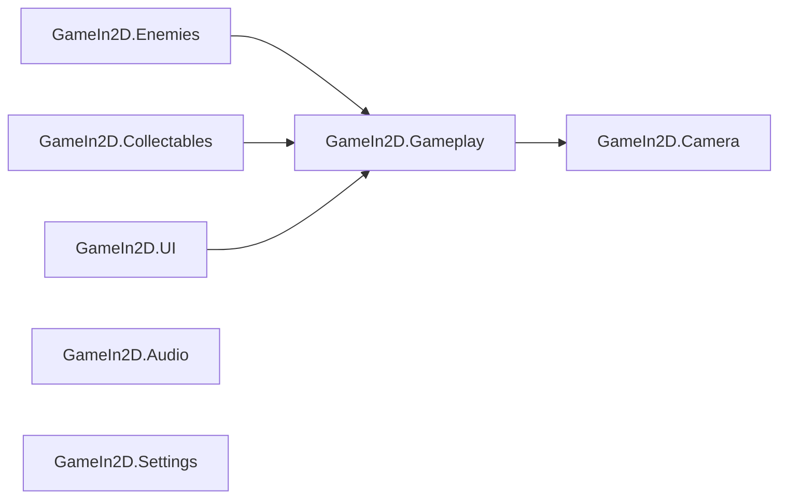

[English](README.md) · **Español**

# 👑 Jorge: El Rey Justiciero


<!-- TODO: agregar los badges de plataforma y licencia cuando estén definidos -->

**Un endless runner medieval en 2D, modernizado a partir de un proyecto legacy de Unity.**

<!-- TODO: reemplazar por un GIF real de gameplay (el fondo de abajo es provisorio) -->


<!-- TODO: descomentar cuando exista la página de itch.io
[**▶ Jugar / ⬇ Descargar en itch.io**](https://emiliano-bazan-zapata.itch.io/...)
-->

---

## Sobre el juego

Jorge corre por un castillo medieval que se genera sobre la marcha. Esquiva o sobrevive a los enemigos, junta monedas y pociones, e intenta superar su mejor distancia.

El juego empezó como un proyecto mío más antiguo. Lo retomé como ejercicio de refactorización: en lugar de reescribirlo, hice evolucionar el código existente paso a paso hacia una estructura más clara y modular, manteniendo el gameplay original.

## Características

- Nivel infinito armado con bloques de castillo conectados: aparece un bloque nuevo adelante mientras se elimina el más viejo.
- Salto normal y un Super Salto que consume maná con una segunda pulsación dentro de los tres segundos.
- Super Carrera mientras se mantiene un botón, con consumo de maná en el tiempo.
- Barras de vida y maná, pociones de vida y de maná, y monedas.
- Enemigos y zonas de muerte que terminan la partida.
- Distancia actual y mejor distancia guardada.
- Pausa, Game Over y reinicio; opciones de brillo, volumen, calidad y resolución.
- Teclado y gamepad compatible con Xbox, activos al mismo tiempo.

## Controles

| Acción                                  | Teclado                 | Gamepad                         |
| --------------------------------------- | ----------------------- | ------------------------------- |
| Moverse a izquierda / derecha           | `A` / `D` o `←` / `→`   | Stick izquierdo o D-Pad         |
| Saltar / Super Salto (segunda pulsación) | `Space`                | A / South                       |
| Super Carrera                           | Mantener `Left Shift`   | Mantener RB                     |
| Pausa                                   | `P`                     | Start / Menu                    |

## Highlights técnicos

- **Modernización incremental, no una reescritura:** cada paso mantuvo el juego jugable y su identidad original.
- **Máquina de estados finita del jugador** con los estados `Idle`, `Run`, `Jump`, `Fall` y `Dead`, y transiciones permitidas explícitas.
- **Migración al Input System:** `PlayerInputReader` define sus propias Input Actions para teclado y gamepad, sin wrapper generado ni componente `PlayerInput`.
- **Siete assembly definitions** con un grafo de dependencias acíclico que deja visible a qué módulo pertenece cada cosa.
- **UI de recursos basada en eventos:** vida y maná emiten eventos de cambio que consumen sus barras.
- **Bugs legacy corregidos:** el giro de los enemigos compartido entre instancias, el consumo de maná dependiente de los frames, la fuerza incorrecta del Super Salto, entre otros.
- **Paquetes reproducibles:** se versionan `manifest.json` y `packages-lock.json`.

## Arquitectura

El juego es un monolito modular pequeño. Las flechas van del assembly que referencia al assembly referenciado.



| Assembly                | Responsabilidad                                   |
| ----------------------- | ------------------------------------------------- |
| `GameIn2D.Gameplay`     | Jugador, flujo de juego y generación del nivel    |
| `GameIn2D.Enemies`      | Movimiento, dirección y daño por contacto         |
| `GameIn2D.Collectables` | Monedas, vida y maná                              |
| `GameIn2D.UI`           | HUD y barras de recursos                          |
| `GameIn2D.Camera`       | Cámara que sigue al jugador                       |
| `GameIn2D.Audio`        | Reproducción de audio                             |
| `GameIn2D.Settings`     | UI de brillo, volumen, calidad y resolución       |

Jugador, flujo de juego y generación del nivel comparten un assembly porque sus responsabilidades todavía están muy conectadas.

### Flujo de input del jugador

```text
Unity Input System → PlayerInputReader → PlayerStateMachine / PlayerMovement → Rigidbody2D y Animator
```

<details>
<summary><b>Recorrido de la modernización</b></summary>

| Antes                                              | Después                                                                    |
| -------------------------------------------------- | -------------------------------------------------------------------------- |
| Controladores amplios con muchas responsabilidades | Componentes específicos de jugador, flujo, generación, UI, enemigos y pickups |
| Scripts sin organización por features             | Carpetas por feature y namespaces `GameIn2D`                               |
| Modos del jugador implícitos                       | Estados explícitos `Idle`, `Run`, `Jump`, `Fall` y `Dead`                  |
| API de input legacy, solo teclado                  | Input System con teclado y gamepad compatible con Xbox                     |
| Estado de giro compartido por todos los enemigos   | Cada enemigo maneja su propia dirección                                    |
| Consumo de maná de la Super Carrera según los frames | Consumo de maná basado en el tiempo                                      |
| Una sola unidad de compilación amplia              | Siete assembly definitions, sin ciclos                                     |

Bugs corregidos representativos:

- Giro de los enemigos aislado por instancia.
- Consumo de maná de la Super Carrera basado en el tiempo.
- Super Salto restaurado a su fuerza configurada.
- Input de pausa migrado al Input System.
- El movimiento horizontal se detiene cuando el input vuelve a neutro, conservando la velocidad vertical.
- La ventana del Super Salto limitada a tres segundos de tiempo de juego.

</details>

<details>
<summary><b>Estructura del proyecto</b></summary>

```text
GameIn2D/
├── Assets/
│   ├── Characters/       Prefabs del jugador y los enemigos
│   ├── Levels/           Prefabs de los bloques del nivel
│   ├── Scenes/           Escenas de juego
│   ├── Scripts/
│   │   ├── Audio/
│   │   ├── Camera/
│   │   ├── Collectables/
│   │   ├── Enemies/
│   │   ├── GameFlow/
│   │   ├── LevelGeneration/
│   │   ├── Player/
│   │   │   ├── Health/  Input/  Lifecycle/  Mana/
│   │   │   ├── Movement/  Progression/  StateMachine/
│   │   ├── Settings/
│   │   └── UI/
│   └── Sprites/          Arte 2D y UI
├── Packages/             manifest.json y packages-lock.json
└── ProjectSettings/
```

</details>

## Testing

El juego se prueba manualmente en Play Mode: movimiento y saltos, ventana del Super Salto, consumo de maná de la Super Carrera, pickups, contacto con enemigos, zonas de muerte, generación del nivel, pausa, Game Over y reinicio.

## Cómo ejecutar el proyecto

### Requisitos

- Unity Hub y Unity **6000.0.72f1**

### Ejecutar en local

```bash
git clone https://github.com/EmilianoBazanZapata/JorgeElReyJusticiero.git
```

1. En Unity Hub, agregar como proyecto la carpeta `GameIn2D` dentro del repositorio.
2. Abrirlo con Unity **6000.0.72f1** y esperar a que restaure los paquetes.
3. Abrir `Assets/Scenes/SampleScene2.unity`.
4. Presionar **Play**.

<!-- TODO: renombrar SampleScene2 a Game y actualizar esta sección -->

## Build

La única escena en Build Settings es `Assets/Scenes/SampleScene2.unity`. Abrir **File > Build Profiles**, elegir la plataforma y presionar **Build**.

## Alcance actual y próximos pasos

El juego está completo y es jugable a pequeña escala. Próximos pasos:

- Tests Edit Mode de vida, maná y transiciones de estado del jugador.
- Eliminar el acceso global que queda (`GameManager.SharedInstance`, `PlayerController.sharedInstance`).
- Medir antes de optimizar: object pooling solo si el Profiler muestra que la generación del nivel es un cuello de botella.
- Un build jugable en itch.io.

## Créditos y assets de terceros

Diseño, programación y refactorización por Emiliano Bazán-Zapata.

| Contenido                                     | Autor                              |
| --------------------------------------------- | ---------------------------------- |
| Props y tiles medievales (pack gratuito)      | <!-- TODO: autor y link -->        |
| Sprites del personaje y los enemigos          | <!-- TODO: autor y link -->        |
| Música (11 temas medievales)                  | <!-- TODO: autor y link -->        |
| Efectos de moneda y salto                     | <!-- TODO: autor y link -->        |
| Fuentes "Super Mario Bros." y "SuperMario256" | <!-- TODO: autor y licencia -->    |
| TextMesh Pro                                  | Unity Technologies                 |

Los assets de terceros pertenecen a sus autores y se usan bajo sus propias licencias.

## Licencia

<!-- TODO: agregar el archivo LICENSE e indicar acá la licencia elegida -->

---

**Binary Suns Studio** · [Web](https://binarysunsstudio.com.ar) · [itch.io](https://emiliano-bazan-zapata.itch.io) · [LinkedIn](https://www.linkedin.com/in/emiliano-bazán-zapata-18705721a)
