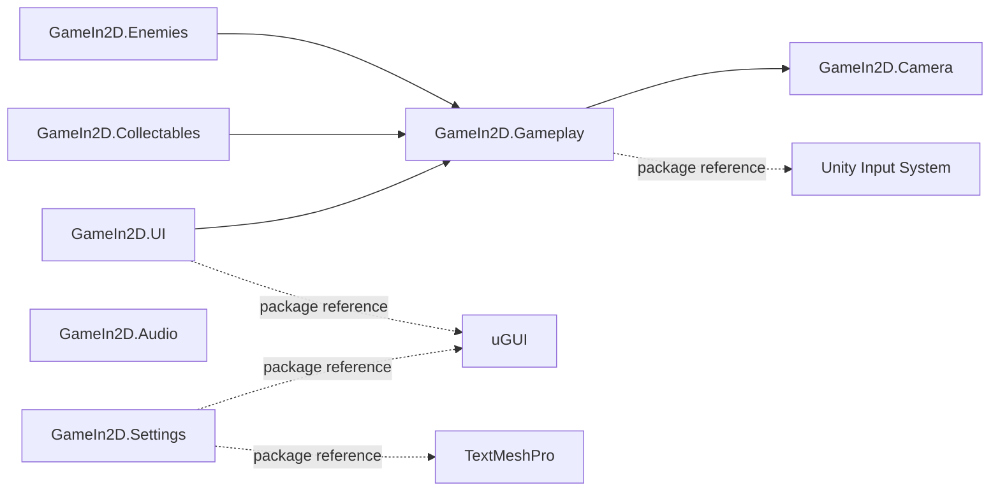

# Jorge: El rey justiciero

`Jorge: El rey justiciero` is a small 2D Unity game in which the player traverses a continuously generated medieval level, avoids or survives enemy contact, collects resources, and pushes for a greater distance. The repository also serves as a portfolio case study in incrementally modernizing a legacy Unity project while preserving its original gameplay identity.


## Overview

The game combines Rigidbody2D character movement, jumping abilities, health and mana management, enemy hazards, collectables, and rolling procedural level generation. A completed engineering pass separated the original responsibilities into focused gameplay modules, migrated input to Unity's modern Input System, introduced explicit compile-time boundaries, and corrected confirmed legacy defects.

The project remains intentionally compact: it demonstrates practical refactoring and technical judgment without presenting a small game as a larger production system.

## Gameplay

The player moves horizontally through generated castle blocks while the camera follows the run. During play, the player can:

- Move left or right with keyboard or an Xbox-compatible controller.
- Perform a normal jump, followed by a mana-powered Super Jump when the second jump input occurs within the three-second activation window.
- Hold Super Run to move faster while consuming mana.
- Collect money, health potions, and mana potions.
- Take damage from enemies or die by entering a KillZone.
- Track collected objects, current distance, and the saved maximum distance.
- Pause, resume, reach Game Over, and restart the run.

Level generation maintains a rolling set of connected blocks: a new block is created as the player advances and the oldest block is removed.

## Controls

Keyboard and gamepad actions are active together; no manual control-scheme selection is required.

| Action | Keyboard | Xbox-compatible gamepad |
|---|---|---|
| Move left | `A` or `Left Arrow` | `Left Stick` left or `D-Pad Left` |
| Move right | `D` or `Right Arrow` | `Left Stick` right or `D-Pad Right` |
| Jump / second-press Super Jump | `Space` | `A` / South button |
| Super Run | Hold `Left Shift` | Hold `RB` / Right Shoulder |
| Pause | `P` | `Start` / Menu button |

Horizontal input is normalized to `-1`, `0`, or `+1` before it reaches movement. The Left Stick uses a `0.2` dead zone, while the D-Pad behaves digitally.

## Technical Highlights

- **Modular Player architecture:** input, movement, health, mana, lifecycle, progression, and state transitions have focused ownership.
- **Finite state machine:** the Player FSM represents `Idle`, `Run`, `Jump`, `Fall`, and `Dead` states.
- **Centralized Game Flow:** menu, gameplay, pause, options, Game Over, restart, and `Time.timeScale` transitions are coordinated through explicit game state.
- **Modern input boundary:** `PlayerInputReader` owns locally constructed Input System actions for keyboard and Xbox-compatible gamepads. No generated wrapper or `PlayerInput` component is required.
- **Feature-oriented modules:** enemies, collectables, UI, camera, audio, settings, game flow, level generation, and Player code are organized by responsibility under `GameIn2D` namespaces.
- **Rolling level ownership:** `LevelGenerator` creates, positions, tracks, and removes connected level blocks.
- **Instance-local enemy direction:** each enemy owns its turnaround state, so a Limit affects only the associated enemy.
- **Event-driven resource UI:** health and mana expose change events consumed by their UI bars.
- **Assembly Definitions:** seven runtime assemblies make compile-time dependencies and module ownership visible.
- **Reproducible packages:** both `Packages/manifest.json` and `Packages/packages-lock.json` are tracked.

## Architecture

The project is a small modular monolith. Player, Game Flow, and Level Generation currently share `GameIn2D.Gameplay` because their source-level responsibilities remain closely connected. The surrounding features use separate runtime assemblies.

Arrows in the diagram point from an assembly to the assembly it references:



The seven project runtime assemblies are:

| Assembly | Responsibility | Project assembly dependencies |
|---|---|---|
| `GameIn2D.Gameplay` | Player, Game Flow, and Level Generation | `GameIn2D.Camera` |
| `GameIn2D.Enemies` | Enemy movement, direction, and contact damage | `GameIn2D.Gameplay` |
| `GameIn2D.Collectables` | Money, health, and mana pickup effects | `GameIn2D.Gameplay` |
| `GameIn2D.UI` | Gameplay HUD and resource bars | `GameIn2D.Gameplay` |
| `GameIn2D.Camera` | Player-follow camera behavior | None |
| `GameIn2D.Audio` | Runtime audio playback behavior | None |
| `GameIn2D.Settings` | Brightness, volume, quality, and resolution UI | None |

Asmdefs were introduced for dependency visibility, clearer ownership, and narrower compilation boundaries. They are not presented as a runtime performance optimization.

### Player structure

```text
Player/
├── Health/          Health state, damage, recovery, and death event
├── Input/           Keyboard and gamepad Input Actions
├── Lifecycle/       Death and restart state
├── Mana/            Mana consumption and recovery
├── Movement/        Rigidbody2D movement and jump abilities
├── Progression/     Distance tracking and position reset
└── StateMachine/    Idle, Run, Jump, Fall, and Dead states
```

Runtime input follows a deliberate boundary:

```text
Unity Input System
→ PlayerInputReader
→ PlayerStateMachine / PlayerMovement
→ Rigidbody2D and Animator
```

## Project Structure

```text
GameIn2D/
├── Assets/
│   ├── Characters/            Player and enemy prefabs
│   ├── Levels/                Generated level-block prefabs
│   ├── Scenes/                Gameplay scenes
│   ├── Scripts/
│   │   ├── Audio/
│   │   ├── Camera/
│   │   ├── Collectables/
│   │   ├── Enemies/
│   │   ├── GameFlow/
│   │   ├── LevelGeneration/
│   │   ├── Player/
│   │   ├── Settings/
│   │   └── UI/
│   └── Sprites/               2D game art and UI assets
├── Packages/                  Reproducible package manifests
└── ProjectSettings/           Unity project configuration
```

Folder ownership and `GameIn2D.*` namespaces mirror the gameplay features where practical.

## Modernization Journey

The project evolved incrementally rather than through a wholesale rewrite.

| Earlier implementation characteristic | Current result |
|---|---|
| Broad, multi-responsibility gameplay controllers | Focused Player, Game Flow, generation, UI, enemy, collectable, camera, audio, and settings components |
| Flatter script organization | Feature-oriented folders and `GameIn2D` namespaces |
| Implicit Player modes | Explicit `Idle`, `Run`, `Jump`, `Fall`, and `Dead` FSM states |
| Legacy input API | Locally owned Unity Input System actions |
| Keyboard-only gameplay input | Keyboard plus Xbox-compatible Left Stick, D-Pad, face, shoulder, and Menu controls |
| Shared enemy turnaround state | Direction state owned by each enemy instance |
| Frame-dependent Super Run mana use | Time-based mana consumption |
| Broad compilation surface | Seven runtime Assembly Definitions with an acyclic dependency graph |
| Speculative optimization opportunities | Evidence-first performance audit with complexity deferred when measurements did not justify it |

### Representative legacy bug fixes

- Isolated enemy turnaround behavior per enemy instance.
- Converted Super Run mana consumption to a time-based rate.
- Restored Super Jump to the configured Super Jump force.
- Migrated Pause input to the Input System.
- Stopped horizontal Rigidbody2D motion when movement input returns to neutral while preserving vertical velocity.
- Limited the second-press Super Jump opportunity to a three-second game-time window.

## Performance Approach

The performance phase reviewed runtime callbacks, component lookups, UI updates, Physics2D work, allocations, and rolling level creation/removal. No FPS improvement is claimed: reliable representative before/after profiler measurements were not available.

No speculative pooling framework or broad micro-optimization pass was introduced. Object pooling remains deferred until a captured Profiler session demonstrates that `Instantiate`/`Destroy` behavior is a meaningful bottleneck at the game's current scale.

## Technology Stack

| Area | Technology |
|---|---|
| Engine | Unity `6000.0.72f1` |
| Language | C# |
| Rendering | Built-in Render Pipeline |
| Input | Unity Input System `1.14.2` |
| UI | uGUI `2.0.0` and TextMeshPro |
| Gameplay physics | Unity 2D Physics / Rigidbody2D |
| Modular boundaries | Unity Assembly Definitions |

## Getting Started

### Requirements

- Git
- Unity Hub
- Unity Editor `6000.0.72f1`

### Run locally

1. Clone this repository with Git.
2. In Unity Hub, add the `GameIn2D` directory inside the clone as a project.
3. Open it with Unity `6000.0.72f1`.
4. Allow Unity Package Manager to restore the dependencies recorded in `Packages/manifest.json` and `Packages/packages-lock.json`.
5. Open `Assets/Scenes/SampleScene2.unity`.
6. Enter Play Mode.

`SampleScene2` is the sole enabled scene in the current Build Settings.

## Current Limitations

- Automated Edit Mode and Play Mode tests are not currently included.
- Player, Game Flow, and Level Generation remain in the shared `GameIn2D.Gameplay` assembly; separating them further would require deliberate contract changes.
- Some legacy global coordinator access remains, including `GameManager.SharedInstance` and `PlayerController.sharedInstance`.
- Performance optimization awaits a representative saved Profiler capture; the existing audit intentionally avoids unsupported performance claims.
- The repository does not currently include portfolio-ready gameplay screenshots.

## Future Work

- Add focused Edit Mode tests for pure state and Play Mode tests for critical scene integration.
- Capture representative CPU, memory, GC, rendering, and Physics2D profiler data before selecting optimization work.
- Continue reducing global coordinator access where it improves ownership without changing gameplay.
- Add curated gameplay screenshots and release packaging for portfolio presentation.

## Package Reproducibility

Unity Package Manager dependencies are recorded in:

- `GameIn2D/Packages/manifest.json`
- `GameIn2D/Packages/packages-lock.json`

Tracking both files preserves the direct dependency declarations and their resolved dependency graph for consistent project restoration.
