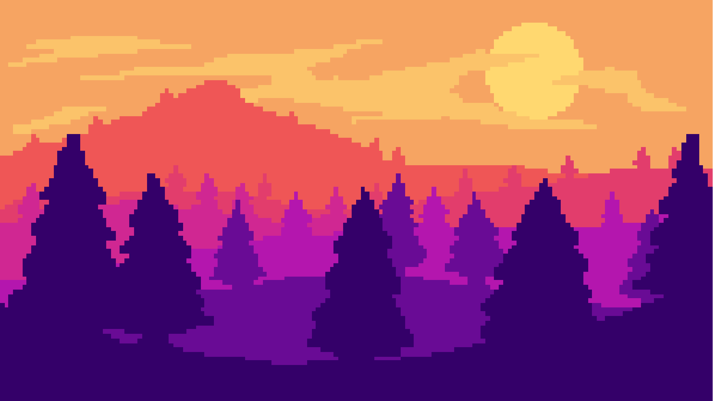
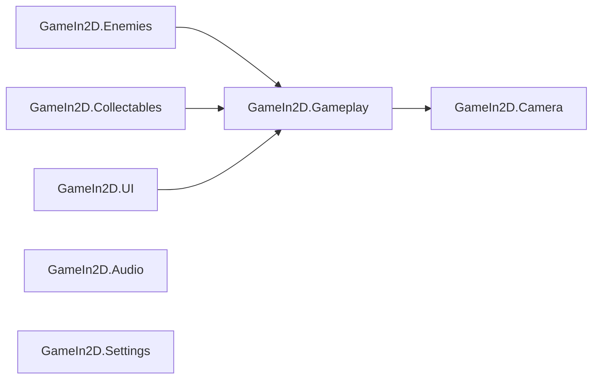

**English** · [Español](README.es.md)

# 👑 Jorge: El Rey Justiciero


<!-- TODO: add platform and license badges once decided -->

**A 2D medieval endless runner, modernized from a legacy Unity project.**

<!-- TODO: replace with a real gameplay GIF (the background art below is a placeholder) -->


<!-- TODO: uncomment once the itch.io page exists
[**▶ Play / ⬇ Download on itch.io**](https://emiliano-bazan-zapata.itch.io/...)
-->

---

## About the game

Jorge runs through a medieval castle generated on the fly. He dodges or survives enemies, collects coins and potions, and tries to beat his best distance.

The game started as an older project of mine. I came back to it as a refactoring exercise: instead of rewriting it, I evolved the existing code step by step into a clearer, modular structure while keeping the original gameplay.

## Features

- Endless level built from connected castle blocks: a new block appears ahead as the oldest one is removed.
- Normal jump, plus a mana-powered Super Jump on a second press within three seconds.
- Super Run while holding a button, consuming mana over time.
- Health and mana bars, health and mana potions, and coins.
- Enemies and kill zones that end the run.
- Current distance and saved best distance.
- Pause, Game Over and restart; settings for brightness, volume, quality and resolution.
- Keyboard and Xbox-compatible gamepad, active at the same time.

## Controls

| Action                         | Keyboard             | Gamepad                         |
| ------------------------------ | -------------------- | ------------------------------- |
| Move left / right              | `A` / `D` or `←` / `→` | Left stick or D-Pad           |
| Jump / Super Jump (second press) | `Space`            | A / South                       |
| Super Run                      | Hold `Left Shift`    | Hold RB                         |
| Pause                          | `P`                  | Start / Menu                    |

## Technical highlights

- **Incremental modernization, not a rewrite:** every step kept the game playable and its original identity.
- **Player finite state machine** with `Idle`, `Run`, `Jump`, `Fall` and `Dead` states and explicit allowed transitions.
- **Input System migration:** `PlayerInputReader` owns its own Input Actions for keyboard and gamepad, with no generated wrapper or `PlayerInput` component.
- **Seven assembly definitions** with an acyclic dependency graph that makes module ownership visible.
- **Event-driven resource UI:** health and mana raise change events that their bars consume.
- **Legacy bugs fixed:** enemy turnaround shared between instances, frame-dependent mana use, wrong Super Jump force, among others.
- **Reproducible packages:** both `manifest.json` and `packages-lock.json` are tracked.

## Architecture

The game is a small modular monolith. Arrows point from the assembly that references to the assembly referenced.



| Assembly                | Responsibility                                 |
| ----------------------- | ---------------------------------------------- |
| `GameIn2D.Gameplay`     | Player, game flow and level generation         |
| `GameIn2D.Enemies`      | Enemy movement, direction and contact damage   |
| `GameIn2D.Collectables` | Coin, health and mana pickups                  |
| `GameIn2D.UI`           | HUD and resource bars                          |
| `GameIn2D.Camera`       | Player-follow camera                           |
| `GameIn2D.Audio`        | Audio playback                                 |
| `GameIn2D.Settings`     | Brightness, volume, quality and resolution UI  |

Player, game flow and level generation share one assembly because their responsibilities are still closely connected.

### Player input flow

```text
Unity Input System → PlayerInputReader → PlayerStateMachine / PlayerMovement → Rigidbody2D and Animator
```

<details>
<summary><b>Modernization journey</b></summary>

| Before                                           | After                                                                 |
| ------------------------------------------------ | --------------------------------------------------------------------- |
| Broad controllers with many responsibilities     | Focused player, game flow, generation, UI, enemy and pickup components |
| Flat script organization                         | Feature folders and `GameIn2D` namespaces                             |
| Implicit player modes                            | Explicit `Idle`, `Run`, `Jump`, `Fall` and `Dead` states               |
| Legacy input API, keyboard only                  | Input System with keyboard and Xbox-compatible gamepad                |
| Turnaround state shared by all enemies           | Each enemy owns its direction                                         |
| Frame-dependent Super Run mana use               | Time-based mana consumption                                           |
| One broad compilation unit                       | Seven assembly definitions, acyclic                                   |

Representative bug fixes:

- Enemy turnaround isolated per instance.
- Super Run mana consumption made time-based.
- Super Jump restored to its configured force.
- Pause input migrated to the Input System.
- Horizontal motion stops when input returns to neutral, keeping vertical velocity.
- The second-press Super Jump window limited to three seconds of game time.

</details>

<details>
<summary><b>Project structure</b></summary>

```text
GameIn2D/
├── Assets/
│   ├── Characters/       Player and enemy prefabs
│   ├── Levels/           Level block prefabs
│   ├── Scenes/           Gameplay scenes
│   ├── Scripts/
│   │   ├── Audio/
│   │   ├── Camera/
│   │   ├── Collectables/
│   │   ├── Enemies/
│   │   ├── GameFlow/
│   │   ├── LevelGeneration/
│   │   ├── Player/
│   │   │   ├── Health/  Input/  Lifecycle/  Mana/
│   │   │   ├── Movement/  Progression/  StateMachine/
│   │   ├── Settings/
│   │   └── UI/
│   └── Sprites/          2D art and UI
├── Packages/             manifest.json and packages-lock.json
└── ProjectSettings/
```

</details>

## Testing

The game is tested manually in Play Mode: movement and jumps, Super Jump window, Super Run mana use, pickups, enemy contact, kill zones, level generation, pause, Game Over and restart.

## Getting started

### Requirements

- Unity Hub and Unity **6000.0.72f1**

### Run locally

```bash
git clone https://github.com/EmilianoBazanZapata/JorgeElReyJusticiero.git
```

1. In Unity Hub, add the `GameIn2D` folder inside the repository as a project.
2. Open it with Unity **6000.0.72f1** and let it restore packages.
3. Open `Assets/Scenes/SampleScene2.unity`.
4. Press **Play**.

<!-- TODO: rename SampleScene2 to Game and update this section -->

## Build

The only scene in Build Settings is `Assets/Scenes/SampleScene2.unity`. Open **File > Build Profiles**, choose a target and press **Build**.

## Current scope and next steps

The game is complete and playable at a small scale. Next steps:

- Edit Mode tests for player health, mana and state transitions.
- Remove the remaining global access (`GameManager.SharedInstance`, `PlayerController.sharedInstance`).
- Profile before optimizing: object pooling only if the Profiler shows level generation as a bottleneck.
- A playable build on itch.io.

## Credits and third-party assets

Design, programming and refactoring by Emiliano Bazán-Zapata.

| Content                                   | Author                     |
| ----------------------------------------- | -------------------------- |
| Medieval props and tiles (free pack)      | <!-- TODO: author and link --> |
| Character and enemy sprites               | <!-- TODO: author and link --> |
| Music (11 medieval tracks)                | <!-- TODO: author and link --> |
| Coin and jump sound effects               | <!-- TODO: author and link --> |
| Fonts "Super Mario Bros." and "SuperMario256" | <!-- TODO: author and license --> |
| TextMesh Pro                              | Unity Technologies         |

Third-party assets belong to their creators and are used under their own licenses.

## License

<!-- TODO: add LICENSE file and state the chosen license here -->

---

**Binary Suns Studio** · [Website](https://binarysunsstudio.com.ar) · [itch.io](https://emiliano-bazan-zapata.itch.io) · [LinkedIn](https://www.linkedin.com/in/emiliano-bazán-zapata-18705721a)
